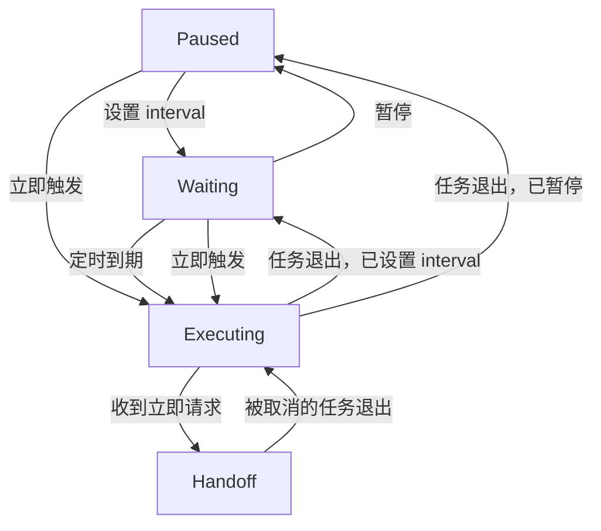
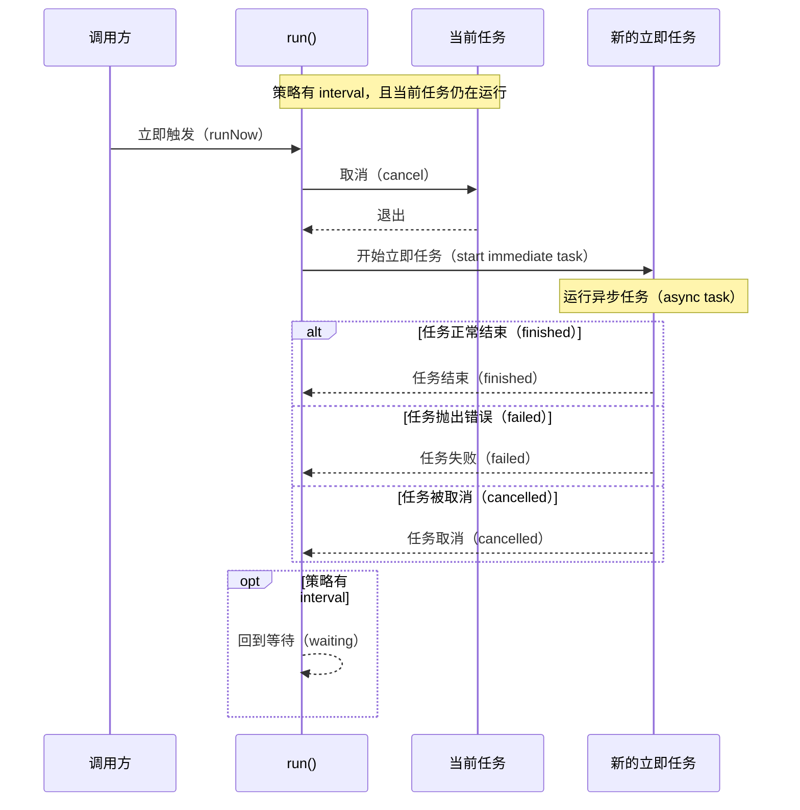

# Swift Sequential Executor

[](https://swiftpackageindex.com/shensven/swift-sequential-executor)
[](https://swiftpackageindex.com/shensven/swift-sequential-executor)

[English](README.md)｜简体中文

让异步任务逐个执行，可按固定延迟运行，也可立即触发并优先于定时任务。

## 为什么不直接用 Timer

[`Timer.scheduledTimer(...)`](https://developer.apple.com/documentation/foundation/timer/scheduledtimer(withtimeinterval:repeats:block:)) 用于调度同步回调。用它执行异步工作时，还需要额外处理任务重叠和取消协调。

## SequentialExecutor 提供了什么

- [x] 按固定延迟依次运行异步任务
- [x] 支持优先于定时调度的立即执行
- [x] 等待与执行都由一个结构化的 `run()` 调用驱动，取消持有它的任务即可停止一切
- [x] 通过同步回调或 `AsyncStream` 提供生命周期事件，方便接入日志、监控或 UI
- [x] 完整的 [API 文档](https://swiftpackageindex.com/shensven/swift-sequential-executor/main/documentation/sequentialexecutor/)

> [!TIP]
> 核心接口只聚焦在 `execute`、`run()`、`updatePolicy(_:)` 和 `runNow()`
>
> 其他细节都被封装在内部 ;-)

## 环境要求

| 平台 | Swift 版本 | 安装方式 | 状态 |
| --- | --- | --- | --- |
| macOS 13.0+<br>iOS 16.0+<br>tvOS 16.0+<br>watchOS 9.0+<br>visionOS 1.0+ | Swift 6.1+ / Xcode 16.3+ | Swift Package Manager | [](https://github.com/shensven/swift-sequential-executor/actions/workflows/tests-apple.yml) |
| Linux | Swift 6.1+ | Swift Package Manager | [](https://github.com/shensven/swift-sequential-executor/actions/workflows/tests-linux.yml) |
| Windows | Swift 6.1+ | Swift Package Manager | [](https://github.com/shensven/swift-sequential-executor/actions/workflows/tests-windows.yml) |

## 安装

### Swift Package Manager

只要你的 Swift 包或 Xcode 工程已经建立好，就可以把 `swift-sequential-executor` 添加到 `Package.swift` 的 `dependencies`，或者加到 Xcode 的包依赖列表里。

添加 `2.0.0` 或更高版本：

```swift
dependencies: [
    .package(url: "https://github.com/shensven/swift-sequential-executor.git", from: "2.0.0")
]
```

然后在 target 中依赖 `SequentialExecutor` 这个产物：

```swift
targets: [
    .target(
        name: "YourTarget",
        dependencies: [
            .product(name: "SequentialExecutor", package: "swift-sequential-executor")
        ]
    )
]
```

## 快速开始

```swift
import Foundation
import SequentialExecutor

let executor = SequentialExecutor(
    execute: { context in
        print("triggered by \(context.source)")
        try await Task.sleep(for: .seconds(2))
    },
    eventHandler: { event in
        print(event.kind)
    }
)

// `run()` 驱动执行器，直到调用它的任务被取消。
let run = Task {
    await executor.run()
}

await executor.updatePolicy(.interval(.seconds(5)))
// await executor.runNow()

// 取消 run，会以协作方式结束正在进行的等待和在途执行。
run.cancel()
```

每次执行都会收到包含执行标识和触发来源的 `ExecutionContext`。`run()` 拥有等待与执行，
应从生命周期与这份工作一致的任务里调用它，例如 SwiftUI 的 `.task` 修饰器。使用
`updatePolicy(_:)` 暂停调度或设置固定延迟；使用 `runNow()` 请求一次优先于定时任务的立即执行。

如果你不需要让初始化器里的 `execute` 参数接收上下文值，也可以使用一个更简洁的便利初始化器：

```swift
let executor = SequentialExecutor {
    try await Task.sleep(for: .seconds(2))
}
```

`eventHandler` 是 `@Sendable` 闭包，并且会在执行器的协调路径上同步调用。请保持处理逻辑轻量，不要在其中同步访问其他隔离域的状态，例如 MainActor UI 状态。需要隔离或异步处理事件时，请通过 `events()` 订阅：

```swift
let executor = SequentialExecutor {
    try await Task.sleep(for: .seconds(2))
}

let eventTask = Task {
    for await event in await executor.events() {
        print(event.kind)
    }
}

let run = Task { await executor.run() }
await executor.runNow()
```

### 立即执行结果

`runNow()` 会返回 `RunNowResult`。`execute` 抛出的错误会以 `.failed` 返回，并同时以
`executionFailed` 事件发出：

```swift
switch await executor.runNow() {
case let .finished(context):
    print("finished: \(context.executionID)")
case let .cancelled(context):
    print("cancelled: \(context.executionID)")
case let .failed(context, error):
    print("failed: \(context.executionID), \(error)")
case let .superseded(requestID, byRequestID):
    print("request \(requestID) was superseded by \(byRequestID)")
case let .notRunning(requestID):
    print("request \(requestID) was made without an active run")
}
```

| 结果 | 含义 |
| --- | --- |
| `finished` | `execute` 正常返回，期间没有收到取消请求。 |
| `cancelled` | 执行器在 `execute` 返回前请求了取消，或 `execute` 抛出了 `CancellationError`。 |
| `failed` | `execute` 抛出了非取消错误，且期间没有收到取消请求。 |
| `superseded` | 请求尚未开始，就被更新请求取代。 |
| `notRunning` | 请求时没有活动中的 `run()`，或 run 在请求开始前已结束。 |

已开始执行的结果由“执行器是否请求过取消”决定，而不是由 `execute` 是否碰巧做完了工作决定。
Swift 的协作式取消允许闭包用两种方式响应：抛出 `CancellationError`，或者提前返回；当闭包
正常返回时，执行器分不清工作是做完了还是放弃了。因此一旦请求过取消，正常返回和抛出错误都
记为 `cancelled`；取消请求之后抛出的错误不再转述。

取消调用方自己的 `Task` 不会撤回已提交给执行器的请求。执行属于 run；只有更新的 `runNow()`
请求或 run 的结束能停止它，取消始终是协作式的。

调用方不需要结果时，可以直接忽略返回值。

### 所有权与生命周期

只有 `run()` 会等待或执行。等待与执行都在 `run()` 持有并始终等待的任务里进行，所以没有任何
东西能活过它：取消调用 `run()` 的任务，进行中的等待或执行会被协作式取消，发出 `runEnded`，
`run()` 返回。没有分离的工作，也没有需要清理的东西。

在 SwiftUI 里，从 `.task` 修饰器调用 `run()`，run 的生命周期就与 View 完全一致；执行器本身
放在真正拥有调度策略的模型里：

```swift
.task { await model.executor.run() }
```

同一时刻只有一个 run 处于活动状态。在另一个 run 活动期间调用 `run()` 会等它结束后再开始，
这让一个 View 的 `.task` 可以无重叠地交接给下一个。`runNow()` 需要活动中的 run；没有时它
立即返回 `.notRunning`，而不是开始一份没有人持有的工作。

策略只控制等待。`.paused` 让 run 空闲，直到策略改变或调用 `runNow()`；`.interval` 在两次
执行之间等待固定延迟。改变策略不会取消已经开始的执行。

`execute` 闭包必须及时响应协作式取消，抛出 `CancellationError` 或提前返回都可以。如果它
正在等待一个非结构化子任务，或者等待不会响应取消的 API，新的 `runNow()` 请求就只能等到旧
工作返回后才能接管。

从多个独立 Task 调用 `updatePolicy(_:)` 时，策略按照 actor 实际收到调用的顺序应用，
这个顺序不保证与 Task 创建顺序一致。应让一个对象统一拥有策略更新，或者在调用方显式
串行化；不要从互不相关的 Task 竞争式地 fire-and-forget 更新策略。

### 事件观察

`events()` 只观察订阅创建之后发出的事件，不会重放历史事件。其默认缓冲区没有
容量上限；需要限制缓冲时，可以使用 `events(bufferingPolicy:)`，但有界缓冲可能丢弃
事件，并且不会额外发出丢弃通知。

顺序保证：

- 对同一个 `executionID`，`executionStarted` 一定先于该次执行的 `executionFinished`、
  `executionCancelled` 或 `executionFailed` 发出。
- `requested(requestID:)` 之后，在该请求有结果之前不会开始任何定时执行；下一个
  `executionStarted` 要么属于该请求，要么属于取代了它的更新的 `runNow()` 请求。
- `runStarted` 先于该 run 的所有等待与执行事件，`runEnded` 是该 run 的最后一个事件。
  run 之间不重叠，因此不同 run 的事件不会交错。
- 请求、run、执行的标识来自同一个执行器内递增的计数器，三者不会共用一个数字，
  数字更大的标识一定更晚发出。

## 行为概览

`SequentialExecutor` 提供以下保证：

- 同一时间只会运行一个异步任务
- 定时任务按固定延迟运行，也可以随时立即触发
- 新任务接管时，当前任务通过协作式取消（cooperative cancellation）退出
- 取消调用 `run()` 的任务，会结束等待和在途执行

### 调度语义

定时执行采用固定延迟（fixed-delay），而不是固定频率（fixed-rate）：

```text
等待 interval → 执行 → 等待 interval → 执行
```

- 设置 interval 后，会先完整等待一个 interval，再开始第一次执行。
- 上一次执行退出后才开始下一次等待，执行耗时不会从延迟中扣除。
- 暂停会取消正在进行的等待，但不会取消已经开始的执行。
- 修改 interval 会重新开始当前等待；如果任务正在执行，新延迟会在任务退出后生效。

<details>
<summary>协调模型</summary>

在一个活动的 run 内，执行器的行为可以读作 4 个状态。实现里并没有存一个状态值，而是跟踪
策略、待处理的立即请求和在途执行，下面的规则由此推出。这张图展示了状态之间的流转：

- `Paused`：run 空闲；策略没有 interval，也没有待处理请求
- `Waiting`：run 正在等待 interval 到期
- `Executing`：有任务在运行，由定时或 `runNow()` 触发
- `Handoff`：任务运行期间收到了立即请求；该任务已被取消，run 正在等它退出



- 在 `Paused` 或 `Waiting` 中收到立即请求时没有需要等待的任务：run 被唤醒，结束进行中的等待，直接开始执行，不经过 `Handoff`。恰好同时到期的 interval 会被该请求占用，不会再开始一次定时执行
- 在 `Waiting` 中更新 interval 后，仍然是 `Waiting`，但旧等待会被取消并重新开始
- 在 `Handoff` 中如果又收到新的立即请求，状态不变，但较早的待处理请求会让位给最新请求
- 在任何状态下取消 run，都会结束进行中的等待或执行，然后 run 返回

</details>

<details>
<summary>轮替流程</summary>

立即请求通过协作式接管执行，不会与当前任务并行：

- 如果 run 正在等待 interval，这段等待会先结束
- 如果当前已经有任务在运行，`runNow()` 会在发出 `requested` 之前取消它，任务通过协作式取消退出
- 新的立即任务只会在前一个任务真正退出后才开始
- 如果轮替期间有多个立即请求到来，最新的请求接管，更早的待处理请求会让位
- 如果当前任务不配合取消，新的立即任务只能继续等待
- 立即任务退出后，如果策略有 interval，run 会回到等待状态

下面的时序图展示了“任务正在运行时收到立即触发”的典型路径：



</details>

## 示例应用

仓库里包含一个 SwiftUI 示例应用，位置在 [`Examples/SequentialExecutorExample`](Examples/SequentialExecutorExample)。运行方式请查看 [Example App 指南](Examples/README.md)。

你可以用它调试和观察 `SequentialExecutor` 的运行时行为，包括策略变化、立即执行、取消协调，以及生命周期事件的发出顺序。这个示例会把可见状态保持为事件驱动，方便直接检查等待与执行的时间线变化。


## 从 1.x 迁移

2.0 是破坏性版本。固定延迟调度和“最新请求胜出”的轮替语义不变；执行器不再持有分离的工作，
API 表面随之调整：

| 1.x | 2.0 |
| --- | --- |
| Swift 6.0+ | Swift 6.1+。`events(bufferingPolicy:)` 的参数类型 `AsyncStream<Event>.Continuation.BufferingPolicy` 从 Swift 6.1 起才是 `Sendable` |
| `updatePolicy(_:)` 会启动由执行器持有的循环 | 从你持有的任务里调用 `run()`，策略只控制等待；取消该任务即停止一切 |
| `Policy()` 或 `.init()` | `.paused` |
| `.init(runLoop: .interval(d))` | `.interval(d)` |
| `Policy.runLoop`、`Policy.RunLoop` | 已移除，直接对 `Policy` 做 switch |
| 没有循环时 `runNow()` 也会执行 | 需要活动中的 `run()`，否则返回 `.notRunning(requestID:)` |
| `loopID`、`executionID` 为 `UUID` | 改为 `UInt`，与 `requestID` 共用同一个执行器内的计数器 |
| `loopStarted`、`loopStopped(reason:)`、`loopExited`、`LoopStopReason` | `runStarted(runID:)` 与 `runEnded(runID:)` |
| `waitStarted(loopID:interval:)`、`waitCancelled(loopID:)`、`intervalElapsed(loopID:)` | 同名事件去掉 `loopID`；run 之间不重叠 |
| `Event.Kind.waitFailed` | 已移除，等待只会以 `waitCancelled` 或 `intervalElapsed` 结束 |
| `ExecutionSource.scheduledLoop(loopID:)` | `.scheduled` |
| `events()` 与 `events(bufferingPolicy: EventBufferingPolicy)` | 合并为 `events(bufferingPolicy:)`，参数类型是 `AsyncStream<Event>.Continuation.BufferingPolicy`，默认 `.unbounded`；`EventBufferingPolicy` 已移除，`events()` 仍可编译 |
| 公开的 `Event.init`、`ExecutionContext.init` | 改为内部，使用者从事件和 `RunNowResult` 读取这些值 |
| 取消请求之后抛出的错误记为 `failed` | 记为 `cancelled`，由取消请求决定结果 |
| `executionStarted` 在执行任务内部发出 | 改为在选中执行时同步发出，见“事件观察”中的顺序保证 |

## 许可证
`swift-sequential-executor` 基于 MIT License 发布。详情请查看 [LICENSE](LICENSE)。
