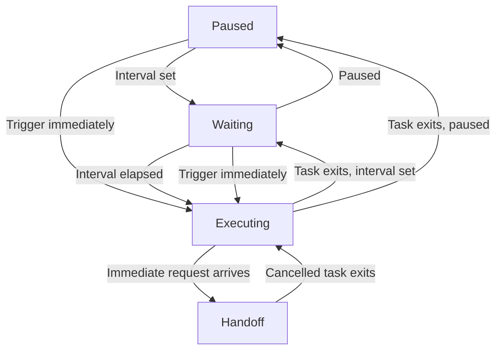
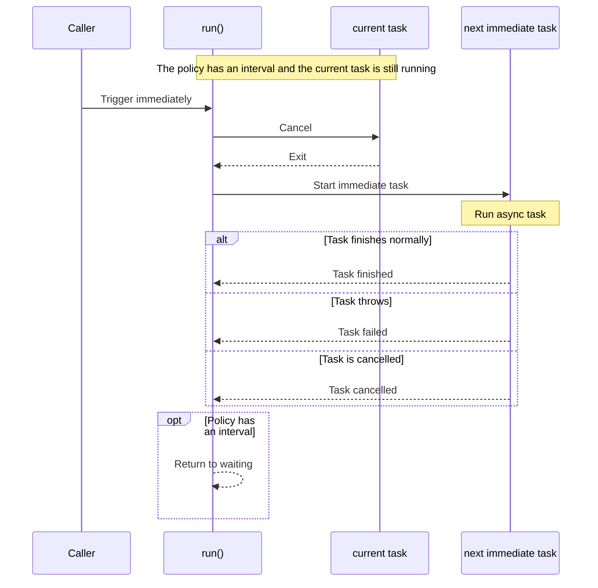
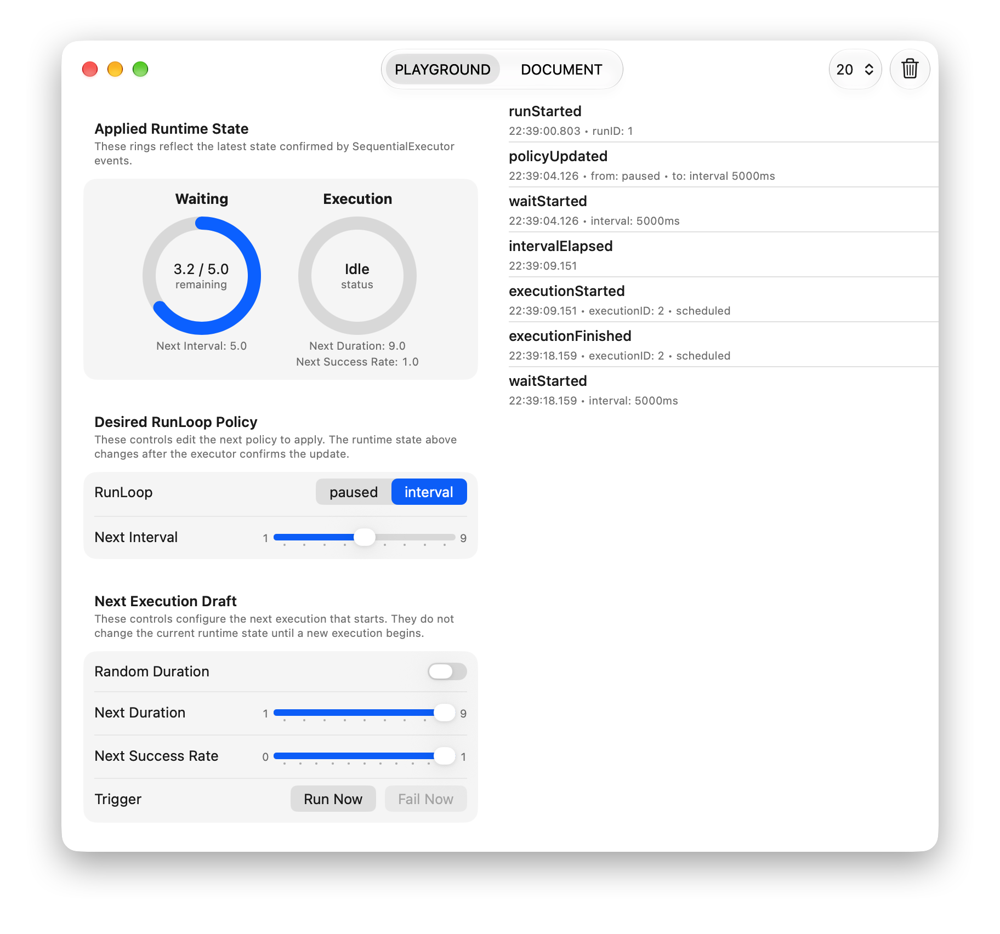

# Swift Sequential Executor

[](https://swiftpackageindex.com/shensven/swift-sequential-executor)
[](https://swiftpackageindex.com/shensven/swift-sequential-executor)

English｜[简体中文](README-zh-CN.md)

Run async tasks one at a time, on schedule or on demand.

## Why Not Just Use Timer

[`Timer.scheduledTimer(...)`](https://developer.apple.com/documentation/foundation/timer/scheduledtimer(withtimeinterval:repeats:block:)) schedules synchronous callbacks. Using it for asynchronous work requires additional coordination to prevent overlap and handle cancellation.

## What SequentialExecutor Provides

- [x] Runs async tasks with a fixed delay between executions
- [x] Supports immediate execution that takes precedence over the schedule
- [x] Drives waiting and executing from one structured `run()` call, so cancelling the task that owns it cancels everything
- [x] Reports lifecycle events through a synchronous handler or an `AsyncStream` for logging, monitoring, or UI integration
- [x] Full [API Documentation](https://swiftpackageindex.com/shensven/swift-sequential-executor/main/documentation/sequentialexecutor/)

> [!TIP]
> The core API stays focused on `execute`, `run()`, `updatePolicy(_:)`, and `runNow()`.
>
> Everything else stays internal ;-)

## Requirements

| Platform | Swift Version | Installation | Status |
| --- | --- | --- | --- |
| macOS 13.0+<br>iOS 16.0+<br>tvOS 16.0+<br>watchOS 9.0+<br>visionOS 1.0+ | Swift 6.1+ / Xcode 16.3+ | Swift Package Manager | [](https://github.com/shensven/swift-sequential-executor/actions/workflows/tests-apple.yml) |
| Linux | Swift 6.1+ | Swift Package Manager | [](https://github.com/shensven/swift-sequential-executor/actions/workflows/tests-linux.yml) |
| Windows | Swift 6.1+ | Swift Package Manager | [](https://github.com/shensven/swift-sequential-executor/actions/workflows/tests-windows.yml) |

## Installation

### Swift Package Manager

Once your Swift package or Xcode project is set up, add `swift-sequential-executor` to `dependencies` in `Package.swift`, or add it to the package dependency list in Xcode.

Add version `2.0.0` or later:

```swift
dependencies: [
    .package(url: "https://github.com/shensven/swift-sequential-executor.git", from: "2.0.0")
]
```

Then depend on the `SequentialExecutor` product from your target:

```swift
targets: [
    .target(
        name: "YourTarget",
        dependencies: [
            .product(name: "SequentialExecutor", package: "swift-sequential-executor")
        ]
    )
]
```

## Quick Start

```swift
import Foundation
import SequentialExecutor

let executor = SequentialExecutor(
    execute: { context in
        print("triggered by \(context.source)")
        try await Task.sleep(for: .seconds(2))
    },
    eventHandler: { event in
        print(event.kind)
    }
)

// `run()` drives the executor until the task that called it is cancelled.
let run = Task {
    await executor.run()
}

await executor.updatePolicy(.interval(.seconds(5)))
// await executor.runNow()

// Cancelling the run ends an active wait and any in-flight execution cooperatively.
run.cancel()
```

Each execution receives an `ExecutionContext` containing its identifier and trigger.
`run()` owns waiting and executing; call it from a task whose lifetime matches the
work, such as a SwiftUI `.task` modifier. Use `updatePolicy(_:)` to pause the
schedule or set its fixed delay, and `runNow()` to request an immediate execution
that takes precedence over the schedule.

If you do not need the `execute` parameter to receive a context value from the initializer, you can also use the simpler convenience initializer:

```swift
let executor = SequentialExecutor {
    try await Task.sleep(for: .seconds(2))
}
```

The event handler is `@Sendable` and runs synchronously on the executor's coordination path. Keep it lightweight, and do not synchronously access state isolated elsewhere, such as MainActor UI state. For isolated or asynchronous event processing, subscribe through `events()` instead:

```swift
let executor = SequentialExecutor {
    try await Task.sleep(for: .seconds(2))
}

let eventTask = Task {
    for await event in await executor.events() {
        print(event.kind)
    }
}

let run = Task { await executor.run() }
await executor.runNow()
```

### Immediate Execution Results

`runNow()` returns a `RunNowResult`. Errors thrown by `execute` are returned as
`.failed` and are also delivered as `executionFailed` events:

```swift
switch await executor.runNow() {
case let .finished(context):
    print("finished: \(context.executionID)")
case let .cancelled(context):
    print("cancelled: \(context.executionID)")
case let .failed(context, error):
    print("failed: \(context.executionID), \(error)")
case let .superseded(requestID, byRequestID):
    print("request \(requestID) was superseded by \(byRequestID)")
case let .notRunning(requestID):
    print("request \(requestID) was made without an active run")
}
```

| Result | Meaning |
| --- | --- |
| `finished` | `execute` returned normally and no cancellation was requested. |
| `cancelled` | The executor requested cancellation before `execute` returned, or `execute` threw `CancellationError`. |
| `failed` | `execute` threw a non-cancellation error while no cancellation was requested. |
| `superseded` | A newer request replaced it before it started. |
| `notRunning` | No `run()` was active when the request was made, or the run ended before the request started. |

The outcome of a started execution is decided by whether the executor requested its
cancellation, not by whether `execute` happened to finish its work. Swift's cooperative
cancellation lets a closure respond either by throwing `CancellationError` or by
returning early, and the executor cannot tell completed work from abandoned work when
the closure returns normally. So once cancellation has been requested, a normal return
and a thrown error are both reported as `cancelled`; an error thrown after a
cancellation request is not reported.

Cancelling the caller's `Task` does not withdraw a request that was submitted to the
executor. The execution belongs to the run; only a newer `runNow()` request or the end
of the run stops it, and cancellation remains cooperative.

The return value is discardable when the caller doesn't need the outcome.

### Ownership and Lifetime

`run()` is the only thing that waits or executes. Waiting and executing happen in
tasks that `run()` owns and always awaits, so nothing outlives it: cancel the task
that called `run()` and an active wait or execution is cancelled cooperatively,
`runEnded` is emitted, and `run()` returns. There is no detached work and nothing to
clean up.

In SwiftUI, call `run()` from a `.task` modifier so the run lives exactly as long as
the view, and keep the executor in the model that owns the scheduling policy:

```swift
.task { await model.executor.run() }
```

Only one run is active at a time. A `run()` call made while another run is active
waits for that run to end before starting, which lets one view's `.task` hand over to
the next without overlap. `runNow()` requires an active run; without one it returns
`.notRunning` immediately instead of starting work that nobody owns.

The policy only controls waiting. `.paused` keeps the run idle until the policy
changes or `runNow()` is called; `.interval` waits for the fixed delay between
executions. Changing the policy never cancels an execution that has already started.

The `execute` closure must respond to cooperative cancellation promptly, either by
throwing `CancellationError` or by returning early. If it waits for an unstructured
child task or an API that ignores cancellation, a newer `runNow()` request cannot take
over until that work returns.

Calls to `updatePolicy(_:)` from independent tasks are applied in actor-arrival
order, which is not guaranteed to match task creation order. Give policy updates
one owner or otherwise serialize them; do not launch competing fire-and-forget
policy updates from unrelated tasks.

### Event Observation

`events()` observes events emitted after the subscription is created and does not
replay earlier events. Its default buffer is unbounded. Use
`events(bufferingPolicy:)` when a bounded buffer is more appropriate; bounded
buffers may drop events without a separate notification.

Ordering guarantees:

- For one `executionID`, `executionStarted` is always emitted before that execution's
  `executionFinished`, `executionCancelled`, or `executionFailed` event.
- After `requested(requestID:)`, no scheduled execution starts until that request has
  settled. The next `executionStarted` belongs either to that request or to a newer
  `runNow()` request that superseded it.
- `runStarted` precedes every wait and execution event of a run, and `runEnded` is the
  last event of a run. Runs never overlap, so events of different runs never interleave.
- Request, run, and execution identifiers come from one increasing counter per
  executor, so no two of them share a number and a larger identifier was issued later.

## Behavior

`SequentialExecutor` provides these guarantees:

- Only one async task runs at a time
- Scheduled tasks use a fixed delay and can also be triggered immediately when needed
- When a new task takes over, the current task exits through cooperative cancellation
- Cancelling the task that called `run()` ends waiting and any in-flight execution

### Scheduling Semantics

Scheduled execution uses fixed-delay rather than fixed-rate semantics:

```text
wait interval → execute → wait interval → execute
```

- Setting an interval waits for one full interval before the first execution.
- The next interval begins only after the previous execution exits, so execution time is not subtracted from the delay.
- Pausing cancels an active wait, but lets an execution that has already started exit normally.
- Changing the interval restarts an active wait. If an execution is already running, the new delay is applied after it exits.

<details>
<summary>Coordination Model</summary>

Within an active run, the executor's behavior reads as four states. The implementation
does not store a state value; it tracks the policy, the pending immediate request, and
the in-flight execution, and the rules below follow from those. The diagram shows how
the states flow:

- `Paused`: the run is idle; the policy has no interval and no request is pending
- `Waiting`: the run is waiting for the interval to elapse
- `Executing`: an execution is running, started by the schedule or by `runNow()`
- `Handoff`: an immediate request arrived while an execution was running; that execution has been cancelled and the run waits for it to exit



- An immediate request from `Paused` or `Waiting` has nothing to wait for, so it starts in the same step
- If the interval is updated while in `Waiting`, the run stays in `Waiting`, but cancels the old wait and starts a new one
- If a newer immediate request arrives while in `Handoff`, the state does not change, but the older pending request yields to the newest one
- Cancelling the run from any state ends the active wait or execution and the run returns

</details>

<details>
<summary>Handoff Flow</summary>

An immediate request performs a cooperative handoff instead of starting concurrent work:

- If the run is waiting for the interval, that wait ends first
- If a task is already running, `runNow()` cancels it before emitting `requested`, and the task exits through cooperative cancellation
- The new immediate task starts only after the previous task has actually exited
- If multiple immediate requests arrive during handoff, the latest one takes over and older pending requests yield
- If the current task does not cooperate with cancellation, the new immediate task has to keep waiting
- After the immediate task exits, the run goes back to waiting if the policy has an interval

The sequence diagram below shows a typical path where a task is already running and an immediate trigger arrives:



</details>

## Example App

The repository includes a SwiftUI example app at [`Examples/SequentialExecutorExample`](Examples/SequentialExecutorExample). See the [Example App guide](Examples/README.md) for instructions.

You can use it to debug and observe the runtime behavior of `SequentialExecutor`, including policy changes, immediate execution, cancellation coordination, and the emission order of lifecycle events. The example keeps visible state event-driven, which makes it easier to inspect waiting and execution timeline changes directly.



## Migrating from 1.x

Version 2.0 is a breaking release. Fixed-delay scheduling and latest-request-wins
handoff are unchanged; the executor no longer owns detached work, and the API surface
follows from that.

| 1.x | 2.0 |
| --- | --- |
| Swift 6.0+ | Swift 6.1+. `events(bufferingPolicy:)` takes `AsyncStream<Event>.Continuation.BufferingPolicy`, which is `Sendable` only from Swift 6.1. |
| `updatePolicy(_:)` started a loop owned by the executor | Call `run()` from a task you own; the policy only controls waiting. Cancel that task to stop everything. |
| `Policy()` or `.init()` | `.paused` |
| `.init(runLoop: .interval(d))` | `.interval(d)` |
| `Policy.runLoop`, `Policy.RunLoop` | Removed. Switch over `Policy` directly. |
| `runNow()` worked without a loop | Requires an active `run()`; otherwise returns `.notRunning(requestID:)`. |
| `loopID` and `executionID` are `UUID` | `UInt`, issued from the same per-executor counter as `requestID` |
| `loopStarted`, `loopStopped(reason:)`, `loopExited`, `LoopStopReason` | `runStarted(runID:)` and `runEnded(runID:)` |
| `waitStarted(loopID:interval:)`, `waitCancelled(loopID:)`, `intervalElapsed(loopID:)` | The same events without `loopID`; runs never overlap. |
| `Event.Kind.waitFailed` | Removed. A wait ends with `waitCancelled` or `intervalElapsed`. |
| `ExecutionSource.scheduledLoop(loopID:)` | `.scheduled` |
| `events()` and `events(bufferingPolicy: EventBufferingPolicy)` | `events(bufferingPolicy:)` taking `AsyncStream<Event>.Continuation.BufferingPolicy`, default `.unbounded`. `EventBufferingPolicy` is removed; `events()` still compiles. |
| Public `Event.init` and `ExecutionContext.init` | Internal. Read these values from events and `RunNowResult`. |
| An error thrown after a cancellation request was `failed` | `cancelled`. A cancellation request decides the outcome. |
| `executionStarted` emitted inside the execution task | Emitted synchronously when the execution is selected. See the ordering guarantees under Event Observation. |

## License
`swift-sequential-executor` is released under the MIT License. See [LICENSE](LICENSE) for details.
